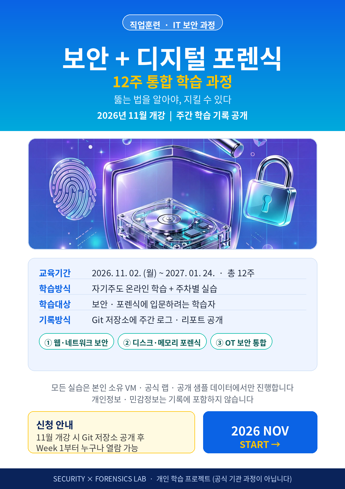

# Security & Forensics Lab

보안과 디지털 포렌식을 함께 공부하는 12주 학습 기록 저장소입니다.

- 시작: 2026년 11월
- 방식: 주간 학습 로그 + 랩 실습 리포트 + 포렌식 분석 리포트
- 원칙: 모든 실습은 본인 소유 VM, 공식 랩, CTF, 공개 샘플 데이터에서만 진행합니다.



## 무엇을 공부하나

| 트랙 | 주제 |
|---|---|
| 보안 | 네트워크, 웹 취약점(OWASP), 시스템 보안, 탐지/로그 분석 |
| 포렌식 | 증거 무결성/해시, 디스크, 메모리, 네트워크 pcap, 타임라인 |
| 통합 | OT/ICS 보안, 사고대응 시나리오, 디지털트윈 연계 |

자세한 계획은 [ROADMAP.md](ROADMAP.md), 주차별 일정은 [SCHEDULE.md](SCHEDULE.md)를 보세요.

## 저장소 구조

```
notes/      개념 정리
labs/       실습 기록 (랩 환경만)
reports/    주간 회고, 취약점/포렌식 리포트
weeks/      주차별 로그
templates/  리포트 템플릿
checklists/ 공개 전 개인정보/민감정보 점검표
assets/     포스터 등 이미지
```

## 공개 원칙 (중요)

이 저장소에는 개인정보와 민감정보를 올리지 않습니다.

- 이름, 이메일, 전화번호, 주소, 회사/학교명, 계정 ID를 쓰지 않습니다.
- 실제 IP, 실제 도메인, 실제 서비스 로그를 올리지 않습니다. 랩 IP(예: 192.168.56.x)와 샘플 데이터만 사용합니다.
- 디스크 이미지, 메모리 덤프, pcap 원본, 비밀번호/토큰/API 키는 절대 커밋하지 않습니다. (.gitignore로 차단)
- 실습 결과는 스크린샷보다 "과정, 명령어, 해석, 배운 점" 중심으로 정리합니다.
- 커밋 전 [checklists/pre-publish-checklist.md](checklists/pre-publish-checklist.md)를 반드시 확인합니다.

## 학습 규칙

- 공격 기법은 항상 탐지, 방어, 패치와 함께 기록합니다.
- 타인 시스템에 대한 무단 접근, 스캔, 테스트는 하지 않습니다.
